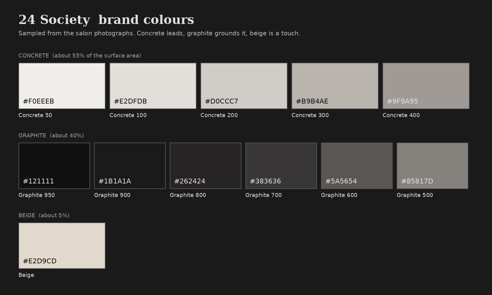

# 24 Society brand kit

Colours are sampled from the salon's own photographs (`img/`), not chosen from a trend palette.

**The finding:** the walls, pillars and floor read as beige on screen because of the warm lamp light. Sampled in neutral spots the concrete is a soft grey (saturation 6–11%, hue about 15°): wall `#aba2a1`, floor `#978c88`, pillar `#9d8a84`. The black chairs sample at `#362f2f`. So the brand is **concrete and graphite**, with beige as a small accent.

## Colours

| Role | Token | Hex | Where it is used |
|---|---|---|---|
| Concrete 50 | `--b-50` | `#f0eeeb` | lightest plaster, form surface |
| Concrete 100 | `--b-100` | `#e2dfdb` | light sections, body text on dark |
| Concrete 200 | `--b-200` | `#d0ccc7` | hover on light |
| Concrete 300 | `--b-300` | `#b9b4ae` | muted text on dark |
| Concrete 400 | `--b-400` | `#9f9a95` | labels on dark |
| Graphite 950 | `--g-950` | `#121111` | footer, loader, deepest ground |
| Graphite 900 | `--g-900` | `#1b1a1a` | page ground |
| Graphite 800 | `--g-800` | `#262424` | cards, raised surfaces |
| Graphite 700 | `--g-700` | `#383636` | rules and borders on dark |
| Graphite 600 | `--g-600` | `#5a5654` | secondary text on concrete |
| Graphite 500 | `--g-500` | `#85817d` | quiet meta |
| **Beige (accent)** | `--beige` | `#e2d9cd` | primary button, italic words, the highlighted card. About 5% of the page. |

Rule: no hue beyond these. Beige never becomes a section background.

## Contrast (WCAG 2.1 AA needs 4.5:1 for body text)

| Pair | Colours | Ratio | Result |
|---|---|---|---|
| Body text on dark | `#e2dfdb` on `#1b1a1a` | 13.1:1 | AA |
| Muted text on dark | `#b9b4ae` on `#1b1a1a` | 8.4:1 | AA |
| Labels on dark | `#9f9a95` on `#1b1a1a` | 6.2:1 | AA |
| Body text on concrete | `#1b1a1a` on `#e2dfdb` | 13.1:1 | AA |
| Secondary text on concrete | `#383636` on `#e2dfdb` | 9.0:1 | AA |
| Labels on concrete | `#5a5654` on `#e2dfdb` | 5.5:1 | AA |
| Button text on beige | `#1b1a1a` on `#e2d9cd` | 12.4:1 | AA |
| Beige italics on dark | `#e2d9cd` on `#1b1a1a` | 12.4:1 | AA |

## Type

- Headings: **Tinos Bold** (the bold Times-style serif on the printed 24 Society sheet), roman and italic.
- Everything else: **Josefin Sans** 400 and 500 (the thin geometric lettering on "Modern Wellness").

## Not in the palette on purpose

The photographs also contain amber lamp light (`#c88d56`) and timber door brown (`#734c31`). They are the light and the wood in the room, not brand colours, so they stay in the photography only.
